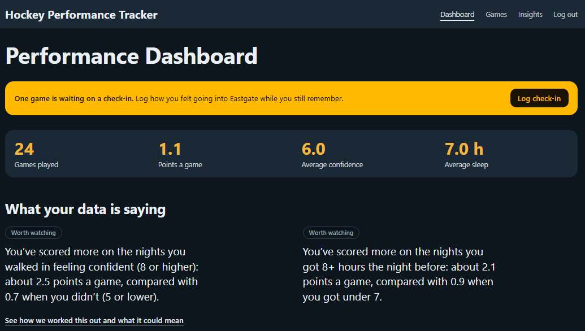
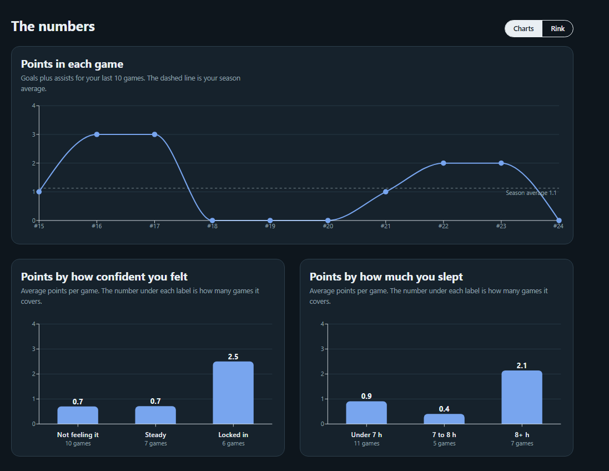
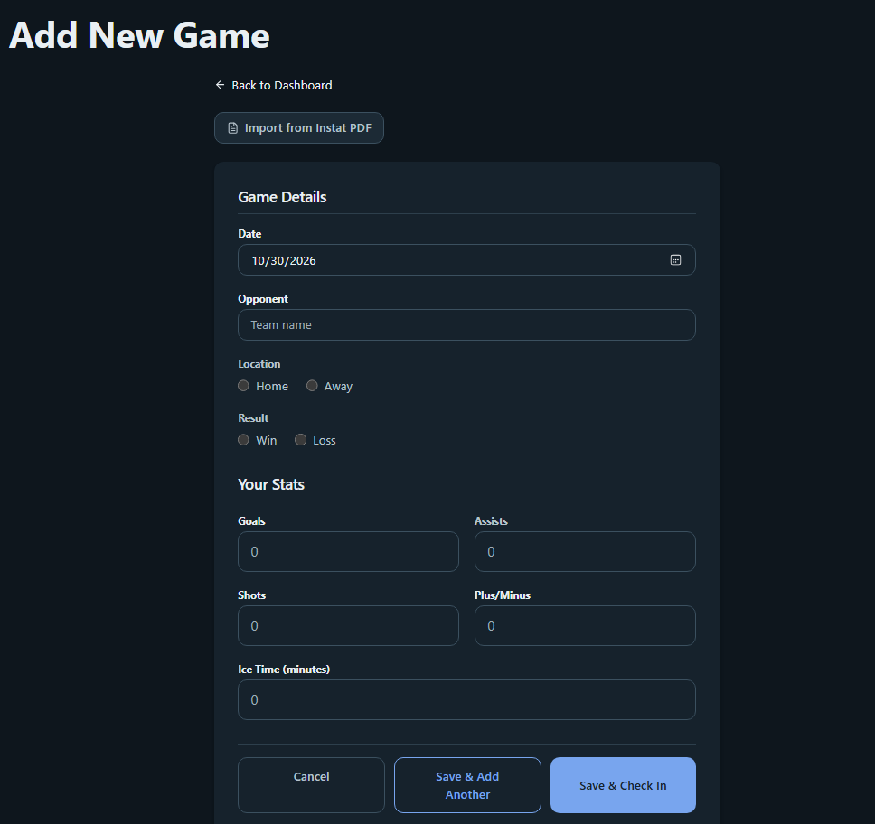
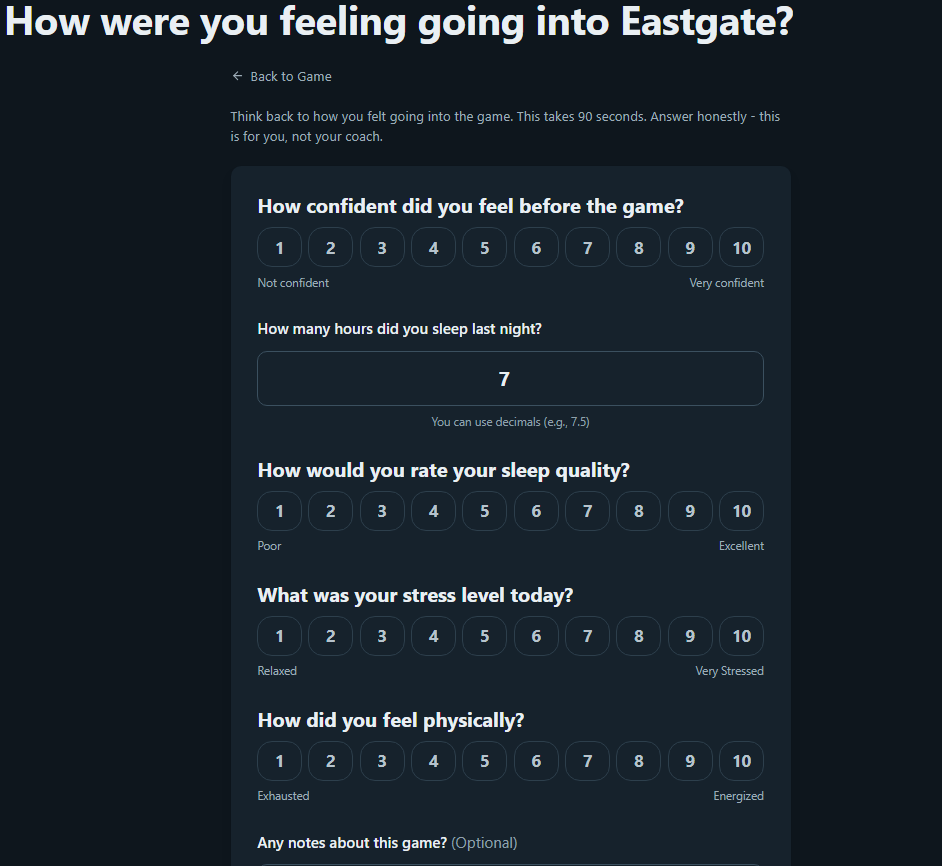

# Hockey Performance Tracker

A full-stack web app that helps hockey players see how **sleep, confidence, stress and energy** connect to their **on-ice results**. Players log game stats (or import an Instat PDF report), answer a 90-second check-in, and the dashboard surfaces patterns such as *"you average more points when confidence is 8+"*.

**[Live demo →](https://hockey-performance-app.vercel.app/)** (use "Try the demo" on the landing page, no sign-up needed)



## Features

- **Game log**: add, edit and delete games with stats (goals, assists, shots, +/-, ice time).
- **Instat PDF import**: upload a report and the stats form is filled in for you.
- **Mental check-in**: confidence, sleep hours and quality, stress and physical energy on 1–10 scales, plus notes.
- **Dashboard**: summary stats, plain-language insights, and charts of points per game and points by confidence and sleep. A Charts | Rink switch shows the same games as pucks on a rink.
- **Insights report**: for each insight, how it was calculated, what went into it, how much to trust it, and what it could mean. Each game page also shows how that game fits your patterns.
- **Demo account**: one click on the landing page loads a seeded sample season (it resets on every demo login).
- **Accounts**: email and password sign-up with JWT sessions; every page and API route is scoped to the signed-in user.
- **NHL shot-data pipeline**: a Python tool that ingests a full NHL season of shot events into Postgres (see [`data-pipeline/`](data-pipeline/README.md)).







## Tech stack

| Layer | Choice |
|---|---|
| Framework | Next.js 16 (App Router), React 19, TypeScript |
| Styling / charts | Tailwind CSS 4, Recharts, lucide-react |
| Auth | NextAuth (credentials, JWT sessions), bcryptjs |
| Database | PostgreSQL via Prisma |
| PDF parsing | pdf-parse |
| Data pipeline | Python, psycopg, NHL public API |
| Tests | Jest (TypeScript), pytest (pipeline) |

## Engineering notes

- **Security:** middleware protects `/dashboard` and `/games`, rate-limits `/api/auth/*` per IP, and the app sends a Content-Security-Policy plus other hardening headers (see [`next.config.ts`](next.config.ts)).
- **Data model:** `User` → `Game` → `MentalState` (one per game), with cascading deletes.
- **Charts:** data shaping lives in pure, unit-tested functions in [`src/lib/chart-utils.ts`](src/lib/chart-utils.ts).
- **Pipeline:** the NHL ingest is idempotent, so re-running a season doesn't duplicate rows.

## Getting started

Requires Node 20+ and a PostgreSQL database.

```bash
npm install
cp .env.example .env        # then fill in the values below
npx prisma migrate deploy
npm run dev                 # http://localhost:3000
```

| Variable | Purpose |
|---|---|
| `DATABASE_URL` | Postgres connection string used by the app |
| `DATABASE_URL_UNPOOLED` | Direct connection used for migrations |
| `NEXTAUTH_SECRET` | Session signing secret (`openssl rand -base64 32`) |
| `NEXTAUTH_URL` | App URL, e.g. `http://localhost:3000` |

## Scripts

```bash
npm test        # Jest unit tests
npm run lint    # ESLint
npm run build   # production build
```

## Project layout

```
app/            Next.js routes: pages, API routes, shared components
src/lib/        auth helpers, Prisma client, chart utilities, PDF parser, rate limiter
prisma/         schema and migrations
data-pipeline/  Python NHL shot-data ingest
```
